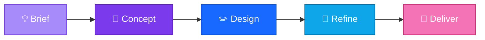

<div align="center">


<a href="https://git.io/typing-svg">
  
</a>

<br/>

[](https://github.com/alamdilshad87)
[](https://www.linkedin.com/in/alamdilshad87)
[](https://www.behance.net/alamdilshad87)

</div>

---

## 🎭 Two Brains, One Builder

<table>
<tr>
<td width="50%" valign="top">

### 💻 The Engineer
*Logic, structure, systems.*

I build reliable backends, clean REST APIs and full-stack apps that do what they promise.

`C#` · `.NET` · `Angular` · `SQL Server` · `Redis` · `JWT` · `Swagger`

</td>
<td width="50%" valign="top">

### 🎨 The Designer
*Emotion, rhythm, identity.*

I turn events and ideas into visual worlds: posters, brand systems, social creatives and motion.

`Branding` · `Posters` · `Social Media` · `Photography` · `Video Editing` · `VFX`

</td>
</tr>
</table>

> **The overlap is where I do my best work:** software that works *and* feels good to use.

---

## 🧾 About Me

```text
$ whoami
> Md Dilshad Alam

$ cat about.txt
> 2026 Computer Science & Engineering graduate, SRMIST.
> Curious about backend systems, APIs, databases and AI.
> Equally at home in an IDE and in a design canvas.

$ status
> Open to SDE, backend (.NET) and full-stack roles ✨
> India, remote or relocation
```

---

## 🛠️ Toolbox

**Languages**


**Frameworks & Development**


**Databases, Tools & Platforms**


<details>
<summary><b>➕ More tech I work with</b></summary>
<br/>

`FastAPI` · `Flask` · `React` · `FAISS` · `Docker` · `RAG` · `ASP.NET Core` · `ASP.NET WebForms` · `ASP.NET Web API` · `ADO.NET` · `Entity Framework` · `RxJS` · `NUnit` · `NLog` · `NumPy` · `Pandas` · `scikit-learn` · `PyTorch` · `OpenCV`

</details>

---

## 💼 Experience

**.NET Developer Intern · BridgeLabz** · Oct 2025 to Jan 2026

- Built RESTful APIs in **ASP.NET Core Web API** with layered architecture, **JWT** auth and **Redis** caching, documented with Swagger and tested with NUnit
- Designed **SQL Server** schemas and queries for database-driven apps
- Built the **Angular** frontend for [FundooNotes](https://github.com/alamdilshad87/FundooNotes_Frontend) on top of the [FundooNotes API](https://github.com/alamdilshad87/FundooNotes)

---

## 🚀 Featured Work

### 🤖 Self-Hosted AI Support System
*Offline document Q&A using Retrieval-Augmented Generation (RAG).*

- Built chunking, embeddings and **FAISS** vector search to retrieve relevant answers from documents
- Developed REST endpoints with **FastAPI** and containerized the app with **Docker**
- Evaluated with **40+ test cases**, reaching an **85% pass rate**

`Python` · `FastAPI` · `FAISS` · `Docker`

📂 [Repository](https://github.com/alamdilshad87/SLM-Major-Proj) (team project)

### 🎯 JobMatrix: AI-Based Resume Matching
*Ranks candidate resumes against a job description.*

- Scored relevance with **TF-IDF vectorization** and **cosine similarity**
- Built parsing workflows to extract structured text from **PDF and DOCX** resumes
- Automated **Top-5 candidate ranking** to speed up screening

`Python` · `Flask` · `NLP` · `Scikit-learn`

📂 [Repository](https://github.com/alamdilshad87/JobMatrix_NLP) · 🌐 [Live demo](https://jobmatrix-nlp.onrender.com/)

### 🛡️ SpecGuard: Intelligent API Analysis Platform
*Turns OpenAPI specs and source code into docs, examples and tests.*

- Generates API documentation, examples and test cases automatically
- **Version comparison** that flags breaking changes in endpoints, request schemas and response contracts
- Automated testing workflows covering positive, negative and edge cases, with backend and frontend integrated

`.NET Core` · `FastAPI` · `React` · `PostgreSQL`

---

## 🎨 Creative Side

<div align="center">

*When I'm not shipping APIs, I'm shaping how things look, feel and get remembered.*

     

</div>

### 🎪 Featured Studio: AARUUSH, SRMIST

As part of the **Creative Committee**, I helped give a large college festival its look and voice:

| | Craft | What I made |
|:-:|---|---|
| 🖼️ | **Posters & Banners** | Eye-catching event visuals built to stop the scroll and the crowd |
| 📱 | **Social Media Creatives** | Consistent, on-brand content for fast-moving promotion |
| 🏷️ | **Event Branding** | Visual identity that ties every touchpoint together |
| 🎬 | **Production Support** | Creative production behind the scenes |

### 🔄 How I Design



### 🎞️ Beyond the Canvas

📸 **Photography**: visual storytelling through the lens  
🎥 **Video Editing & VFX**: motion, pacing and effects  
✍️ **Editorial (SRMKzilla)**: words and layouts that communicate  
🌍 **Open-source learning**: building and contributing in public  
🤝 **Student Affairs Committee**: coordinating events and keeping them running smoothly

<div align="center">

<br/>

<a href="https://www.behance.net/alamdilshad87">
  
</a>

</div>

---

## 🧪 Currently Exploring

- 🏗️ Backend engineering & software architecture
- 🔌 Reliable, maintainable REST APIs
- 🤖 AI applications, LLMs and RAG
- 📊 Data analytics & machine learning
- ✨ Modern frontend & interactive web experiences

---

## 📊 GitHub Stats

<div align="center">


</div>

---

## 🤝 Let's Connect

Whether it's an API, a brand, or an idea that needs both, I'd love to hear about it.

<div align="center">

<a href="https://github.com/alamdilshad87"></a>
<a href="https://www.linkedin.com/in/alamdilshad87"></a>
<a href="https://www.behance.net/alamdilshad87"></a>

<br/>

*Code is how I build. Design is how I communicate. Curiosity is what drives me.*


</div>
